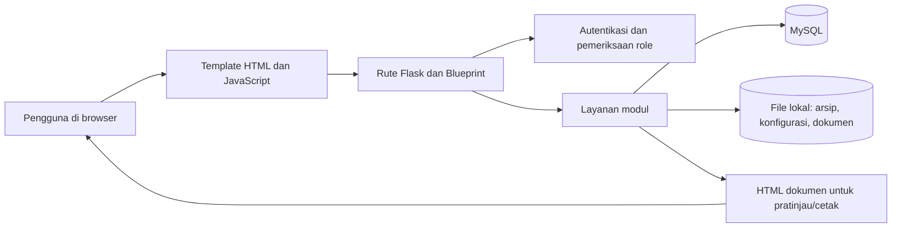

# Panduan Proyek Live Invoice PTBSS Test

Dokumen ini menjelaskan struktur dan cara kerja aplikasi untuk pengembang atau administrator yang melanjutkan proyek. Aplikasi ini adalah sistem internal untuk mengelola data kontrak, Proforma Invoice (PI), rincian pekerjaan, Purchase Order (PO), realisasi/opname, dokumen proyek, invoice, dan arsip pendukung.

> Panduan ini disusun dari kode dan struktur repository saat ini. Nama tabel, alur, dan fitur mengikuti implementasi yang ditemukan; verifikasi deployment tetap perlu dilakukan terhadap database dan konfigurasi server yang dipakai.

## 1. Ringkasan sistem

Aplikasi berjalan sebagai aplikasi web Flask. Browser menampilkan halaman HTML/Jinja dan JavaScript; JavaScript memanggil endpoint Flask untuk membaca atau mengubah data. Flask memvalidasi sesi dan role, menjalankan logika pada modul layanan, lalu mengakses MySQL atau penyimpanan file lokal.

**Sumber data utama** adalah MySQL. Aplikasi juga menggunakan file lokal untuk dokumen arsip, konfigurasi Master Paket Batch, master rekening bank, logo, dan beberapa artefak lama. Jangan menganggap file Excel di folder penyimpanan lokal sebagai pengganti database aktif; beberapa workbook merupakan data lama atau referensi.

## 2. Teknologi dan cara menjalankan

- Python, Flask, Jinja, dan Werkzeug.
- MySQL melalui `mysql-connector-python`, dengan pool koneksi bersama di `db_connection.py`.
- `openpyxl` untuk membaca workbook lama dan file Excel.
- Passenger/WSGI melalui `passenger_wsgi.py` untuk pola deployment yang disiapkan.
- Aset browser ada di `templates/` dan `static/`.

Dependensi saat ini tercantum di `requirements.txt`. Versinya belum dipatok, jadi lingkungan baru dapat memasang versi berbeda dari lingkungan deployment.

### Konfigurasi lingkungan

Atur setidaknya variabel database berikut sebelum menjalankan aplikasi:

| Variabel | Fungsi | Nilai bawaan |
| --- | --- | --- |
| `DB_HOST` | Host MySQL | Wajib diisi |
| `DB_PORT` | Port MySQL | `3306` |
| `DB_NAME` | Nama database | Wajib diisi |
| `DB_USER` | Pengguna MySQL | Wajib diisi |
| `DB_PASSWORD` | Password MySQL | Wajib diisi |
| `DB_POOL_SIZE` | Jumlah koneksi dalam pool | `6` |
| `DB_POOL_RESET_SESSION` | Mengaktifkan reset session saat koneksi dikembalikan | `false` |
| `SECRET_KEY` | Kunci penandatangan cookie sesi Flask | Disarankan diatur di environment |
| `SECRET_KEY_FILE` | Lokasi file fallback kunci sesi | `instance/session_secret_key` |
| `APP_HOST` | Host server lokal saat `app.py` dijalankan langsung | `127.0.0.1` |
| `APP_PORT` | Port server lokal | `5000` |
| `LOG_LEVEL` | Level logging Python | `INFO` |

Untuk pengembangan lokal, pasang dependensi dari `requirements.txt`, atur environment variable, lalu jalankan `python app.py`. Server lokal secara default hanya mendengarkan `127.0.0.1`. Untuk Passenger, entry point WSGI adalah `passenger_wsgi.py`, yang mengimpor `application` dari `app.py`.

Jangan memasukkan password database atau kunci deployment ke Git. Folder `instance/` saat ini memuat file kunci fallback yang tercatat dalam repository; siapkan kunci baru di konfigurasi deployment dan tinjau riwayat Git sebelum repository dibagikan.

## 3. Struktur file dan tanggung jawab

### Entry point dan konfigurasi

| File/folder | Tanggung jawab |
| --- | --- |
| `app.py` | Membuat aplikasi Flask, memuat secret key, memasang `ProxyFix`, mendaftarkan blueprint, menjalankan bootstrap tertentu, menambahkan context template, rute dasar, error handler, dan response headers. |
| `passenger_wsgi.py` | Menambahkan direktori proyek ke `sys.path`, mengatur batas thread numerik, lalu mengekspor aplikasi WSGI sebagai `application`. |
| `requirements.txt` | Daftar dependensi Python. |
| `db_connection.py` | Membuat pool MySQL dari environment, menyediakan context manager koneksi, validasi nama tabel, pembacaan metadata, dan helper baca/simpan data umum. |
| `create_admin.py` | Skrip administrasi untuk membuat atau memperbarui akun Super Admin. Skrip ini mengubah akun ketika dieksekusi; jangan jalankan tanpa meninjau kredensial dan dampaknya. |
| `stderr.log` | Log runtime yang berada di repository saat ini; log bukan sumber konfigurasi aplikasi dan sebaiknya tidak dijadikan artefak source control. |

### Modul aplikasi

| Lokasi | Fungsi utama dan file penting |
| --- | --- |
| `modul_keamanan/` | `routes.py` menangani login, logout, dan manajemen pengguna; `auth_service.py` memeriksa password hash dan melakukan operasi pengguna; `decorators.py` menyediakan `login_required` dan `role_required`. `autentikasi.py` adalah file lama yang menggunakan Streamlit. |
| `modul_navigasi/` | `routes.py` adalah blueprint utama untuk dashboard, data master, kontrak/PI, Modul 2, invoice/pajak, pemantauan pembayaran, dan endpoint terkait. `database_master_bank.json` menyimpan master bank tambahan yang dibaca Modul 2. |
| `modul_input/` | `modul_0_referensi.py` mengelola referensi; `modul_1_database.py` memuat dan mengubah data kontrak/PI; `modul_1_person_master.py` mengelola master personel. |
| `modul_po/` | `master_po.py` menyediakan blueprint Master PO, skema PO, item PO, ledger realisasi, aturan pemetaan, analitik, dan operasi CRUD. `templates/master_po.html` adalah antarmuka modul. |
| `modul_opname/` | `routes.py` menyediakan halaman dan API Opname; `services.py` membangun konteks PI/PO, menghitung nilai sebelumnya/aktual/kumulatif/sisa, serta menyimpan snapshot; `po_mapping.py` membantu pemetaan dan rekonsiliasi item. Template mandiri berada di `templates/opname.html`. |
| `modul_dokumen/` | Generator HTML dokumen, registry/engine dokumen, perender paket, konfigurasi paket, branding/logo, layanan arsip, dan rute arsip. Beberapa generator: BASTB, BASP, BAMP, WCC, TKDN, Proforma Invoice, rincian pekerjaan, dan timesheet. |
| `modul_keuangan/` | Berisi helper invoice dan modul billing/pajak lama. `modul_billing_tax.py` masih mengimpor Streamlit; rute Flask Modul 3 utama ada di `modul_navigasi/routes.py`. |
| `templates/` | Tampilan login, dashboard, master data, editor dokumen, invoice resmi/faktur pajak/kuitansi, halaman arsip, dan manajemen pengguna. `templates/layout/` berisi kerangka halaman dan sidebar. |
| `static/` | CSS umum, CSS invoice, CSS arsip, dan `static/js/archive-documents.js` untuk interaksi halaman arsip. Sebagian UI lain memiliki JavaScript langsung di template HTML. |
| `database_penyimpanan_aman/` | File runtime dan data lama/operasional: workbook, hasil dokumen HTML, file TKDN/WCC JSON, logo, konfigurasi paket, dan direktori arsip. Lokasi ini digunakan langsung oleh kode. |
| `instance/` | Konfigurasi/runtime lokal Flask. Saat ini ada file fallback secret key. |
| `tmp/` | File sementara dan skrip pemeriksaan impor; bukan bagian dari alur bisnis normal. |

File `.pyc`, direktori `__pycache__`, beberapa file `.bak`, dan data produksi/contoh juga tercatat di repository. File-file tersebut bukan source of truth untuk implementasi; periksa riwayat Git sebelum membersihkan atau membagikan repository.

### File invoice yang mirip namanya

Ada dua file bernama `invoice_documents.py`. Rute Flask utama mengimpor `invoice_context` dan `receipt_context` dari file root `invoice_documents.py`. File `modul_keuangan/invoice_documents.py` adalah salinan/modul lain; sebelum mengubah keduanya, telusuri import agar perubahan masuk ke implementasi yang benar.

## 4. Siklus hidup request

1. Passenger memuat `passenger_wsgi.py`, atau pengembang menjalankan `app.py` secara langsung.
2. `create_app()` membuat Flask app dan menentukan session key. Kunci berasal dari `SECRET_KEY` atau file `SECRET_KEY_FILE`/`instance/session_secret_key`.
3. Aplikasi mendaftarkan blueprint autentikasi, navigasi, arsip, Master PO, dan Opname.
4. Saat bootstrap, aplikasi mencoba menyiapkan skema Master PO serta tabel arsip. Kegagalan bootstrap dicatat di log dan tidak selalu menghentikan startup.
5. Request halaman/API masuk ke route. Route biasanya memeriksa login; operasi mutasi juga menggunakan pemeriksaan role/`can_write()` sesuai modul.
6. Handler memanggil fungsi layanan, mengambil/mengubah MySQL melalui `get_db_connection()`, dan/atau membaca/menulis file lokal.
7. Respons berupa HTML, JSON, atau file unduhan. `after_request` memasang sejumlah header keamanan dan kebijakan cache.

Endpoint dasar yang tersedia antara lain `/health`, `/health/database`, `/api/status`, serta dashboard `/dashboard`. Beberapa endpoint pemeriksaan/debug juga ada; lihat bagian keamanan sebelum memublikasikannya.

## 5. Alur bisnis dan data

### A. Login dan akses pengguna

1. Form login POST ke route `auth.login`.
2. `modul_keamanan.auth_service.autentikasi_user()` mencari pengguna aktif di `database_users` dan memverifikasi hash melalui Werkzeug.
3. Username, ID, nama, departemen, dan role disimpan di session Flask yang ditandatangani.
4. `login_required` menjaga halaman/API yang memerlukan login. `role_required` digunakan untuk akses khusus seperti manajemen akun.
5. Aturan role tambahan berada di route dan helper modul, misalnya `_has_archive_access()` untuk arsip dan `can_write()` untuk operasi tulis.

Role arsip didefinisikan di `modul_dokumen/archive_service.py`. Kategori invoice/pajak tertentu bersifat privat dan hanya dapat diakses oleh role yang tercantum di `PRIVATE_ARCHIVE_ROLES`. Untuk menambah/mengubah role, periksa route, decorator, helper tulis, dan template navigasi sekaligus.

### B. Kontrak, PI, dan rincian transaksi

1. Master kontrak dan PI dikelola oleh API Modul 1 melalui `modul_navigasi/routes.py` dan `modul_input/modul_1_database.py`.
2. Tabel utama PI adalah `database_proforma_invoice`; kolom dipetakan menggunakan metadata database dan alias karena beberapa instalasi memiliki variasi nama kolom.
3. Data rincian/tagihan pekerjaan berada di `database_transaksi_rincian`.
4. Modul 2 memilih kontrak dan PI, memuat metadata PI dan baris transaksi, lalu menentukan daftar dokumen berdasarkan `jenis_bastp`.
5. Saat rincian Modul 2 disimpan, route memvalidasi data dan menulis detail transaksi beserta metadata seperti PO, item PO, kategori, kuantitas, harga, persentase, tanggal, rekening, dan tipe dokumen.

`database_transaksi_rincian` adalah tabel penghubung penting: digunakan oleh halaman PI, dokumen, Master PO, invoice, dan Opname. Perubahan skema atau proses edit PI perlu diperiksa terhadap seluruh pemakainya.

### C. Master PO, pemetaan, dan Opname

1. Master PO disimpan di `database_master_po`, item PO di `database_master_po_item`.
2. Pemetaan PI/rincian ke item PO menggunakan `po_item_id`, aturan pemetaan, dan fungsi sinkronisasi di `modul_po/master_po.py`.
3. Ledger realisasi PO berada di `database_po_realisasi`; data ini mendukung pemakaian plafon dan analitik.
4. Modul Opname memuat PI, PO, dan realisasi terdahulu, lalu menampilkan volume/nilai sebelumnya, aktual, kumulatif, dan sisa. Perhitungan mencakup jenis provisional/estimated serta UOM berbasis nilai.
5. Penyimpanan Opname menghapus snapshot untuk kombinasi kontrak/PI/PO terpilih lalu menyimpan baris terbaru ke `database_opname` dalam satu transaksi.
6. Pemetaan item dapat direkonsiliasi melalui endpoint `/opname/api/po/reconcile`; perubahan PO juga dapat memicu remapping realisasi.

Skema Master PO dibuat melalui `bootstrap_master_po()`. Skema Opname disiapkan oleh `ensure_opname_schema()` ketika halaman/API Opname atau paket dokumen memerlukan tabel tersebut. Fitur inti lainnya mengandalkan tabel yang sudah tersedia di database.

### D. Generator dokumen dan paket batch

`modul_dokumen/document_engine.py` berisi registry dokumen. Engine memilih generator berdasarkan kode, memuat generator secara lazy, dan menghasilkan HTML. Dokumen generator meliputi Proforma Invoice, rincian pekerjaan, BAMP, BASP, BASTB, dan WCC; TKDN dan Opname memiliki alur/rute sendiri.

Alur paket:

1. Pengguna memilih kontrak dan PI di Modul 2.
2. Aplikasi membaca master PI dan rincian transaksi.
3. Layanan paket memuat TKDN tersimpan dari `database_tkdn`, Opname tersimpan/dihitung dari konteks aktif, serta konfigurasi paket untuk kontrak+PI.
4. `document_package_renderer.py` menghasilkan satu HTML gabungan dengan sampul dan bagian dokumen terpilih.
5. Konfigurasi pemilihan dokumen/logo disimpan di `database_penyimpanan_aman/master_paket_batch_config.json`; logo dapat berasal dari file lokal atau pengaturan logo lama.
6. Pengguna melihat/mencetak HTML dari browser. File hasil cetak yang sudah disimpan juga terdapat di `database_penyimpanan_aman/paket_dokumen_tersimpan/`.

Registry urutan paket ada di `PACKAGE_ORDER` dalam `document_engine.py`. Jika menambah dokumen, periksa registry, generator/route, manifest per jenis BASTP, renderer paket, pengaturan konfigurasi, dan UI Modul 2.

### E. Invoice, faktur pajak, pembayaran

Alur invoice resmi berada terutama di `modul_navigasi/routes.py`, bukan di `modul_keuangan/modul_billing_tax.py` yang berbasis Streamlit. API Modul 3 menyediakan sumber kontrak/PI, kalkulasi invoice, daftar/detail, create/update/salin/hapus, referensi pajak, arsip invoice, audit, dan pemantauan pembayaran. Halaman utama memakai `templates/invoice_tax.html`.

`invoice_documents.py` root menyusun context invoice dan kuitansi dari data invoice serta transaksi. Hasilnya dirender memakai `templates/invoice_official.html` dan `templates/invoice_receipt.html`. Perubahan formula perlu diselaraskan antara endpoint kalkulasi, proses simpan, data transaksi sumber, dan template cetak.

### F. Arsip dokumen

1. Metadata arsip disimpan di `database_document_archive`; riwayat tindakan berada di `database_document_archive_audit`.
2. File unggahan disimpan ke direktori kategori di `database_penyimpanan_aman/arsip_dokumen_customer/` memakai nama file internal acak.
3. `archive_routes.py` menyediakan pencarian/paginasi, unggah, pratinjau, unduh, dan hapus. File diunduh/dipr preview setelah pengecekan bahwa path berada di akar arsip.
4. Kategori invoice resmi, faktur pajak, SSP PPN, dan bukti potong PPh dibatasi sebagai kategori privat.
5. Saat startup, `archive_service.py` mencoba mengimpor indeks metadata lama dari `metadata_arsip.xlsx` tanpa memindahkan file lama.

Penghapusan arsip memperbarui status database dan menghapus file fisik. Backup arsip sebaiknya mencakup metadata database dan direktori file; keduanya perlu konsisten saat restore.

### G. Penyimpanan lokal tambahan

- `modul_navigasi/database_master_bank.json`: tambahan master bank yang digabung dengan rekening yang ditemukan pada transaksi lama.
- `database_penyimpanan_aman/master_paket_batch_config.json`: konfigurasi paket per nomor kontrak + PI.
- `database_penyimpanan_aman/tkdn_tersimpan/` dan `wcc_tersimpan/`: file JSON hasil simpan/legacy.
- `database_penyimpanan_aman/paket_dokumen_tersimpan/`: hasil HTML paket yang telah disimpan.
- `database_penyimpanan_aman/pengaturan_logo_permanen/` dan file logo: aset branding yang dipakai generator.
- `database_penyimpanan_aman/arsip_dokumen_customer/`: metadata dan berkas arsip customer.
- Workbook `.xlsx`: data lama, referensi, atau hasil ekspor; penggunaan tiap workbook harus ditelusuri sebelum dianggap aktif.

## 6. Rute penting

Rute dapat berubah; definisi aktual berada di decorator dalam source.

| Area | Prefix/rute utama | Modul |
| --- | --- | --- |
| Login | `/login`, `/logout` | `modul_keamanan/routes.py` |
| Dashboard | `/dashboard`, `/api/dashboard/*` | `app.py`, `modul_navigasi/routes.py` |
| Referensi | `/modul/master-referensi`, `/api/modul-0/*` | `modul_navigasi/routes.py` |
| Kontrak dan PI | `/modul/database-kontrak`, `/api/modul-1/*` | `modul_navigasi/routes.py` |
| Modul 2 | `/modul/invoice-dokumen`, `/api/modul-2/*` | `modul_navigasi/routes.py` |
| Invoice/pajak | `/modul/invoice-tax`, `/api/modul-3/*` | `modul_navigasi/routes.py` |
| Master PO | `/master-po/`, `/master-po/api*` | `modul_po/master_po.py` |
| Opname | `/opname/`, `/opname/api/*` | `modul_opname/routes.py` |
| Arsip | `/modul/arsip`, `/api/archive-documents*` | `modul_dokumen/archive_routes.py` |
| Personel | `/master/personil`, `/api/modul-1/persons*` | `modul_navigasi/routes.py` |

`/health` memeriksa proses aplikasi; `/health/database` memeriksa MySQL. Endpoint `/debug/routes` dan `/test-invoice-ptbsssatu` juga ada di source dan perlu ditinjau sebelum tersedia di internet.

## 7. Skema database yang terlihat dari source

Tabel inti yang dirujuk oleh kode meliputi:

| Tabel | Peran |
| --- | --- |
| `database_users` | Pengguna, role, status, dan hash password |
| `database_proforma_invoice` | Master PI dan metadata kontrak |
| `database_transaksi_rincian` | Rincian pekerjaan/tagihan dan referensi PO |
| `database_master_referensi` | Kategori/UOM/deskripsi referensi |
| `database_master_po` | Header PO dan versi/status |
| `database_master_po_item` | Rincian item serta plafon PO |
| `database_po_realisasi` | Ledger kuantitas/nilai realisasi ke item PO |
| `database_po_mapping_rule` | Aturan pemetaan transaksi ke item PO |
| `database_opname` | Snapshot per kontrak/PI/PO dan item opname |
| `database_tkdn` | Data tersimpan TKDN, termasuk parameter JSON |
| `database_document_archive` | Metadata file arsip |
| `database_document_archive_audit` | Audit unggah, lihat, unduh, dan hapus arsip |
| `database_master_invoice`, `database_invoice_payment` | Tabel yang dirujuk Master PO untuk ringkasan invoice/pembayaran |

Tabel invoice Modul 3 dan tabel sumber lainnya juga digunakan oleh route navigasi; telusuri query di `modul_navigasi/routes.py` untuk mendapatkan daftar lengkap sesuai versi database. Tidak ada direktori migration versioned yang tampak dalam repository. Sebagian schema dibuat otomatis saat startup/pemakaian; tabel bisnis utama harus sudah disediakan dan kompatibel.

## 8. Memahami kode saat membuat perubahan

1. Temukan route/endpoint di `modul_navigasi/routes.py`, `modul_po/master_po.py`, `modul_opname/routes.py`, atau `modul_dokumen/archive_routes.py`.
2. Ikuti fungsi layanan yang dipanggil hingga query MySQL atau akses file.
3. Periksa template dan JavaScript pemanggil endpoint; banyak UI menggunakan `fetch()` langsung di file HTML.
4. Untuk data PI, telusuri dampaknya ke `database_transaksi_rincian`, pemetaan PO, Opname, generator dokumen, dan invoice.
5. Untuk dokumen, periksa generator mandiri dan paket batch; keduanya mungkin memakai data tersimpan dengan bentuk yang berbeda.
6. Untuk perubahan database, periksa bootstrap/schema, kompatibilitas tabel lama, transaksi commit/rollback, dan backup sebelum migrasi.
7. Catat perubahan environment, tabel, route, dan langkah deployment di panduan ini setelah implementasi berubah.

Nama tabel atau kolom yang berasal dari schema dinamis/legacy dapat berbeda antar instalasi. Jangan mengubah penamaan atau formula keuangan tanpa membandingkan struktur database deployment dan sampel dokumen yang disetujui.

## 9. Keamanan, backup, dan batasan yang diketahui

- File bisnis (workbook, PDF, JSON, dan HTML hasil dokumen) serta fallback secret key saat ini tercatat di Git. Batasi akses repository; buat rencana untuk mengeluarkan data/secret dari versi kontrol dan menangani riwayat commit.
- `create_admin.py` mengatur akun admin saat dijalankan; jangan jalankan sebagai langkah startup.
- Sesi menyimpan role yang ditetapkan saat login. Perubahan role/nonaktif akun tidak otomatis memaksa logout sesi yang sudah berjalan.
- Ada route diagnostik yang terbuka di source. Pastikan aksesnya sesuai sebelum deployment publik.
- Mekanisme CSRF token tidak tampak pada formulir/API saat ini; logout memakai GET. Tinjau sebelum menambah operasi sensitif atau memperluas akses lintas domain.
- `requirements.txt` belum mematok versi dependensi; dokumentasikan versi Python, MySQL/MariaDB, dan library yang sudah diverifikasi untuk deployment.
- Source mencakup sejumlah file lama berbasis Streamlit dan file backup. Entry point Flask yang disiapkan adalah `app.py`; jangan menganggap semua file lama bagian dari runtime aktif tanpa memeriksa import.
- Repository saat ini belum menunjukkan suite test otomatis. Sebelum rilis, jalankan pemeriksaan di lingkungan terpisah dengan database uji; hindari menggunakan database produksi untuk eksperimen.

Backup yang dapat dipulihkan perlu mencakup dump MySQL, file arsip customer, konfigurasi paket, master bank, logo, serta file hasil dokumen yang masih dibutuhkan. Uji restore pada lingkungan terpisah dan cocokkan metadata arsip dengan file fisiknya.

## 10. Status cakupan dokumentasi

Panduan ini merangkum struktur source, titik masuk Flask, modul, tabel yang terlihat, alur data, dan penyimpanan yang dirujuk kode. Ini bukan spesifikasi bisnis formal: validasi angka/formula dan aturan approval tetap perlu dikonfirmasi dengan pemilik proses. Aplikasi, koneksi MySQL, deployment Passenger, dan tampilan seluruh PDF/Excel belum diuji dari panduan ini.
